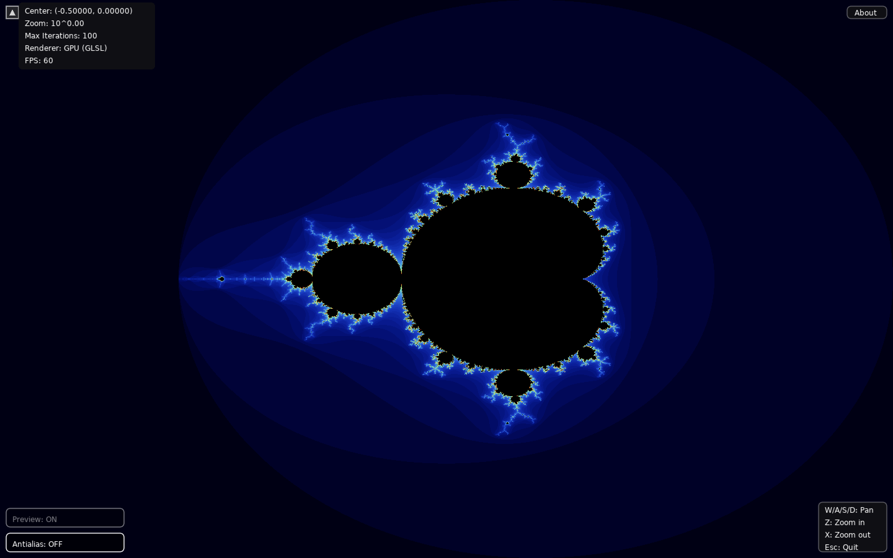
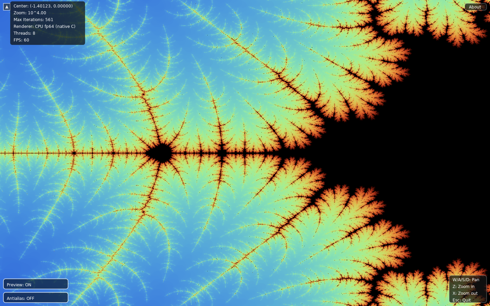
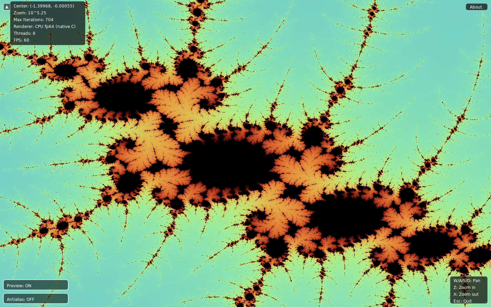
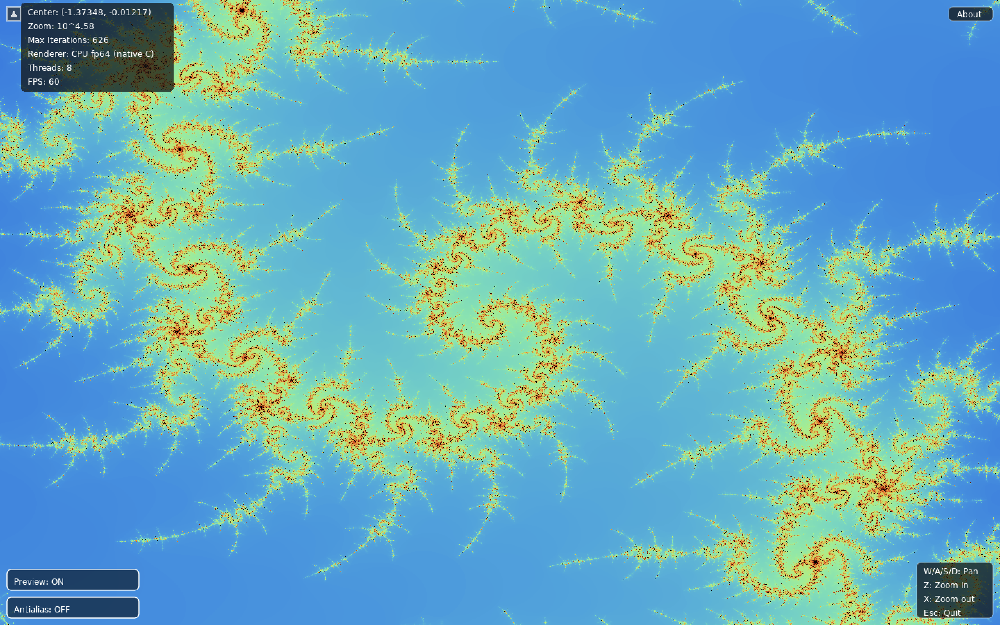
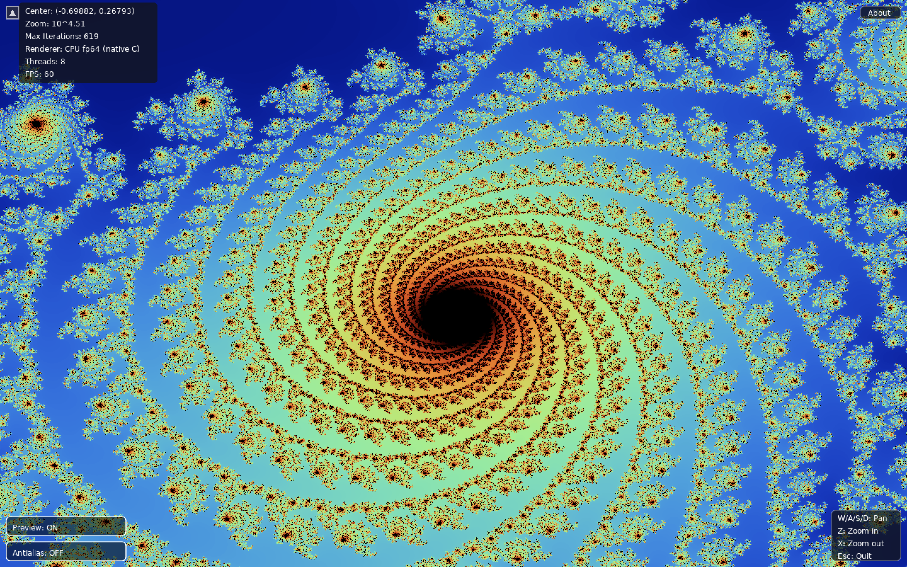
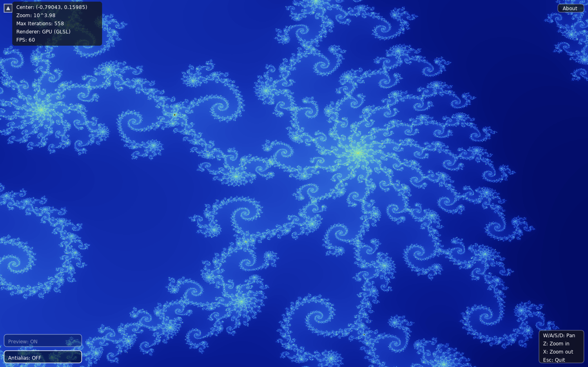

# Mandelbrot in Lua (Love2D)

This project is an interactive Mandelbrot set explorer built using [Love2D](https://love2d.org/).  
You can pan around and zoom into the fractal in real time with keyboard controls. It runs in full-screen and uses a performance-optimized native C library to compute the fractal efficiently.

**Supported platforms:** Windows, macOS, Linux, Web

All platform builds are produced automatically by GitHub Actions — every push to `main` publishes download artifacts for macOS, Windows, Linux, and a WASM web build.

---

## Screenshots

|  |  |  |
|------------------------------------------|------------------------------------------|------------------------------------------|
|  |  |  |

---

## Controls

| Key | Action           |
|-----|------------------|
| W   | Pan up           |
| A   | Pan left         |
| S   | Pan down         |
| D   | Pan right        |
| Z   | Zoom in          |
| X   | Zoom out         |
| ESC | Quit the program |

On the web build, ESC closes the page's request to exit and clicks are used for the on-screen toggles (stats, preview, antialias).

---

## How to Run

### From a CI build

1. Go to the **Actions** tab of this repository, open the latest **Build Desktop** run.
2. Download the artifact for your platform (`mandelbrot-macos`, `mandelbrot-windows`, or `mandelbrot-linux`) and unpack it.
3. Install [Love2D](https://love2d.org/) for your platform, then run:

```sh
love mandelbrot/          # the unzipped folder containing main.lua
```

### macOS

```sh
git clone <this repo> && cd mandelbrot-lua
clang -O3 -funroll-loops -shared -o mandelbrot.dylib -fPIC mandelbrot.c
love .                    # requires love on your PATH (brew users: see note below)
```

> The Homebrew cask for Love2D is currently disabled (Gatekeeper check). Temporary workaround:
> download `love-11.x-macos.zip` from the [LÖVE GitHub releases](https://github.com/love2d/love/releases),
> run `xattr -cr love.app` after unpacking, then invoke `love.app/Contents/MacOS/love .`.

### Windows (MinGW)

```sh
gcc -O3 -funroll-loops -shared -o mandelbrot.dll -fPIC mandelbrot.c
love .
```

### Linux

```sh
gcc -O3 -funroll-loops -shared -o mandelbrot.so -fPIC mandelbrot.c
love .
```

The Lua code detects your OS and automatically loads `mandelbrot.dll`, `mandelbrot.dylib`, or `mandelbrot.so` — so the compiled library must sit next to `main.lua`.

### Web (WebAssembly)

The web build uses [love.js](https://github.com/Davidobot/love.js) (Emscripten/WASM). Build locally with [bun](https://bun.sh):

```sh
bunx love.js . build/web -c -t "Mandelbrot"
cd build/web
python3 -m http.server 8000   # must be served over HTTP, file:// will not work
```

Then open `http://localhost:8000` locally. On GitHub Actions, the **Build Web (WASM)** workflow produces a ready-to-serve `mandelbrot-web` zip artifact (e.g. for itch.io).

### Continuous deployment to Netlify

The repo includes a `netlify.toml`, so Netlify builds and serves the WASM build automatically. Connect the repo on Netlify and leave the project settings **empty** — the build command and publish directory (`dist`) come from `netlify.toml`.

> **Note on the web build:** love.js does not include LuaJIT, so the FFI-based native library is unavailable. `main.lua` automatically falls back to a pure-Lua Mandelbrot renderer — same output and features (including the GLSL shader), but single-threaded and slower. Enable **Preview** mode on the web for comfortable navigation.

---

### Compiling the C Shared Library

The desktop builds use a native C function for fast Mandelbrot rendering, compiled into a shared library sitting next to `main.lua` (`mandelbrot.dll` / `mandelbrot.so` / `mandelbrot.dylib`). Without it, the game falls back to the slower pure-Lua renderer — so compiling is strongly recommended for desktop play (see the platform commands under [How to Run](#how-to-run)).

---

## Features

- Full-screen rendering
- Real-time panning and zooming
- Dynamically adjusts iteration count for detail at high zoom
- Colored smooth shading

---

## Performance Optimizations

This project includes several key optimizations to ensure smooth, real-time Mandelbrot rendering:

- **Native C backend (desktop):** Mandelbrot calculations are done in a compiled C shared library via LuaJIT FFI, with an automatic pure-Lua fallback when FFI is unavailable (web builds).
- **Multithreaded computation:** Rows are processed in parallel using multiple threads (auto-detected at runtime).
- **Loop unrolling:** Enabled via -funroll-loops during compilation for faster iteration performance.
- **Cached bounds:** xmin, xmax, ymin, and ymax are calculated only when zoom or pan occurs.
- **Dynamic max iterations:** Automatically increases with zoom level for visual detail, with clamping to avoid lag.
- **Clamped zoom precision:** Prevents zoom from becoming too small due to floating-point limits.
- **GLSL fragment shader coloring:** Coloring is handled entirely on the GPU for smooth gradients and zero CPU cost.
- **GPU-accelerated texture rendering:** Fractal data is uploaded to a texture and drawn in one pass for efficiency.

---

## Requirements

- [Love2D](https://love2d.org/) 11.0 or later (desktop)
- C compiler (desktop — optional, for the native renderer)
- [bun](https://bun.sh) and a static web server (web build)

---

## License

This project is released under the MIT License.
